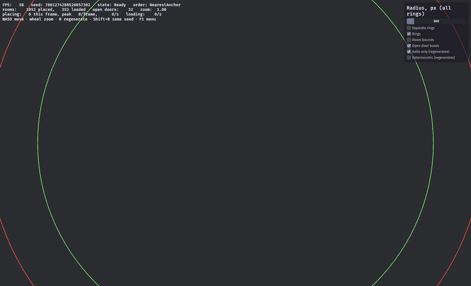

# bevy_ldtk_procgen

[](https://github.com/ezraclintoc/bevy_ldtk_procgen/actions/workflows/nightly.yaml)
[](https://github.com/ezraclintoc/bevy_ldtk_procgen)

A procedural, room-by-room level generator for Bevy and LDtk (`bevy_ecs_ldtk`). Author a
catalog of rooms as LDtk levels, mark their doors, and the plugin connects them into a
non-linear layout at runtime — no hand-authored dungeon required.

> [!WARNING]
> **Pre-alpha.** Public API changes without notice.



*`cargo run --release --example testing`, halls mode, seed 102. First half: the
default order, filling doors nearest the camera. Second half: deterministic
order, a disc grown from the origin at ~4,000 rooms/s; only rooms inside the
green ring are spawned. The HUD shows rooms placed per frame and per second.
FPS is capped by the recording monitor's 60 Hz vsync.*

## Compatibility

| `bevy_ldtk_procgen` | `bevy` | `bevy_ecs_ldtk` |
| ------------------- | ------ | --------------- |
| unreleased          | `0.18` | `0.14`          |

## Features

### Implemented

- Catalog built from an LDtk project: rooms, doors (direction from the level
  edge, any width the art uses), bool and float tags, per-room weights.
- Doors from `Door` entities, or found automatically from the gaps in an
  IntGrid wall layer (`with_door_source(DoorSource::IntGridGaps { layer })`).
- Synchronous generation in a per-frame budget, with the layout as the single
  source of truth.
- Door-to-door placement with door reservations: every open door keeps the
  full footprint of a room that could fill it free, so a door can never be
  sealed, two open doors never compete for the same space, and no door is
  born facing another room's wall.
- Spatially indexed rooms *and* open doors, so placement cost stays flat as
  the dungeon grows (~9.5 µs per room out to 100,000 rooms).
- Two door orders (`GenerationOrder`): `NearestAnchor` (default) fills
  around the anchor; `FromOrigin` is **deterministic** — the same seed gives the
  same dungeon however it was explored and however fast each frame ran.
- Three independently configurable rings (`StreamingRadii`, changeable at
  runtime): generation (rooms placed as data, ahead of the player), spawn and
  despawn. The spawn/despawn gap is enforced, so no setting can load and
  unload a room on alternate frames.
- Streaming: rooms spawn near a `GenerationAnchor`, nearest first, and are
  culled behind it without ever mutating the layout. The spawn budget adapts
  to each machine's frame time (or is fixed, if you prefer).
- Every dungeon has a reportable seed (`GenerationSeed`), random ones
  included.
- Meta-generation: a consumer weight table plus engine-side quotas, depth
  gates, closure bias and multi-door preference.
- Regeneration on demand (`Regenerate`), with a fresh or a given seed.
- Authoring feedback at load: missing cap rooms are an error naming the
  direction; doors too close together for their rooms to fit are a warning
  naming the level and doors.
- Point → room queries, connectivity via open doors, and events for every
  placement, spawn, despawn, abandoned door and catalog failure.

### Planned

- An 18px project. The crate is grid-agnostic and the 512px Mossy Cavern map
  is tested locally (its art can't be redistributed), but no 18px map exists
  yet.
- Tag transition table wiring (`WeightConfig::tag_transition`).
- Saving and loading a layout.
- Hot reload of the `.ldtk` project.

## Quick start

```rust
use bevy::prelude::*;
use bevy_ecs_ldtk::prelude::*;
use bevy_ldtk_procgen::prelude::*;

fn main() {
    App::new()
        .add_plugins((DefaultPlugins, LdtkPlugin))
        // Rooms load within 800 px of the anchor, are placed out to 1600 px,
        // and unload beyond 1000 px.
        .add_plugins(GeneratorPlugin::new("my_rooms.ldtk", 800.0).with_seed(1234))
        .add_systems(Startup, |mut commands: Commands| {
            // Generation follows whatever carries the anchor.
            commands.spawn((Camera2d, GenerationAnchor));
        })
        .run();
}
```

Builder options: `with_generation_radius`, `with_culling`, `with_order`, `with_placement_budget`, `with_spawn_budget`, `with_door_source`,
`with_start`, `with_max_rooms`, `with_weight_config`.

## Examples

```bash
cargo run --release --example <name> [-- <map.ldtk>]   # map path relative to assets/
```

| Example | Shows |
|---|---|
| `minimal` | The output API: placement/spawn events and point → room queries. |
| `halls` | A player with wall collision in an endless corridor maze (a consumer weight table). |
| `meta` | Meta-generation: a bounded dungeon that closes off gracefully. |
| `testing` | The debug harness in the video: rings, room bounds, door reservations, FPS and throughput, halls and deterministic toggles. F1 opens the menu. |

All examples: **WASD** moves, **R** regenerates with a new seed, **Shift+R**
regenerates the same seed.

## Performance

Release build, bundled 16px catalog:

| | |
|---|---|
| Placing a room (layout data only) | ~9.5 µs, flat from 10k to 100k rooms |
| Spawning a room (`bevy_ecs_ldtk` tilemaps) | ~2.6 µs per tile (~0.1 ms for a typical room) |
| Loading ~300 rooms after a teleport | 0.07-0.12 s, no frame over 20 ms (60 Hz) |
| Generator share of a frame while streaming | under 0.2 ms of 7 ms |

Placement is cheap and spawning is not, so the defaults place rooms well ahead
of what is loaded and spawn them nearest first, within a per-frame budget that
adapts to the machine: it learns the normal frame time and spawns as much as
fits without a visible stutter, so a slow laptop loads rooms more slowly
instead of hitching (`SpawnBudget`; `SpawnRate` shows where it settled). The placement
benchmark: `cargo test --release --lib bench_ -- --ignored --nocapture`.

## Installation

Not published to crates.io yet, so add it as a git dependency:

```toml
[dependencies]
bevy_ldtk_procgen = { git = "https://github.com/ezraclintoc/bevy_ldtk_procgen" }
```

Pin a commit while the crate is pre-alpha, since `main` moves without regard for
breaking changes:

```toml
bevy_ldtk_procgen = { git = "https://github.com/ezraclintoc/bevy_ldtk_procgen", rev = "<commit sha>" }
```

Bevy needs system graphics, input, and audio libraries present at runtime. On NixOS the
flake in this repo provides them:

```bash
nix develop
```

### Bundled assets

`assets/kenney_tiny-dungeon_16px.png` is CC0 and ships with the repo, along with
the 16px project the examples use.

The Mossy Cavern tileset is not redistributable, so neither it nor the 512px map
built on it is in this repository; both are kept local and gitignored. To build
your own map on it, download [Mossy Cavern](https://maaot.itch.io/mossy-cavern) by
Maaot (name your own price, free is fine) and place the 512px tileset at
`assets/maaot_mossy-cavern_512px.png`. The 512px test
(`local_512px_map_keeps_door_invariants`) runs when
`assets/ezraclintoc_maaot-mossy-cavern_512px_variabledoors.ldtk` is present and
skips otherwise.

## Contributing

Issues and pull requests are welcome. The repo is set up to be built from the flake:

```bash
nix develop          # cargo, rustc, rust-analyzer, clippy, rustfmt, prek, typos
prek install         # install the pre-commit hooks
```

Before opening a pull request:

```bash
cargo fmt --all
cargo clippy --all-targets --all-features
cargo test
```

Notes for contributors:

- The lint policy in `Cargo.toml` denies `unwrap`, `expect`, `panic`, `todo`,
  `unimplemented`, and direct indexing. Return errors instead.
- Commit messages follow Conventional Commits (`feat(maps): ...`, `chore(tooling): ...`).
- `AGENTS.md` documents the crate layout and the LDtk authoring conventions.

## License

Dual-licensed under either [MIT](LICENSE-MIT) or [Apache License, Version 2.0](LICENSE-APACHE), at your option — the standard convention for Rust crates.

Licenses apply to the source code only. Bundled art assets carry their own terms, listed below.

## Asset Credits

- Tilesets:
  - [Tiny Dungeon](https://kenney.nl/assets/tiny-dungeon) by [Kenney](https://kenney.nl) — `assets/kenney_tiny-dungeon_16px.png`, licensed [CC0 1.0 Universal](https://creativecommons.org/publicdomain/zero/1.0/).
  - [Pixel Platformer](https://kenney.nl/assets/pixel-platformer) by [Kenney](https://kenney.nl) — `assets/kenney_pixel-platformer_18px.png`, licensed [CC0 1.0 Universal](https://creativecommons.org/publicdomain/zero/1.0/). Used as the 18px test catalog, to keep tile-size assumptions honest.
  - [Mossy Cavern](https://maaot.itch.io/mossy-cavern) by [Maaot](https://maaot.itch.io/) — **not bundled**, download it yourself (see [Bundled assets](#bundled-assets)). Free and commercial use permitted, modification permitted, credit appreciated but not required; redistribution, repackaging, and resale are not permitted, modified or otherwise — which is why the image is not committed here.
