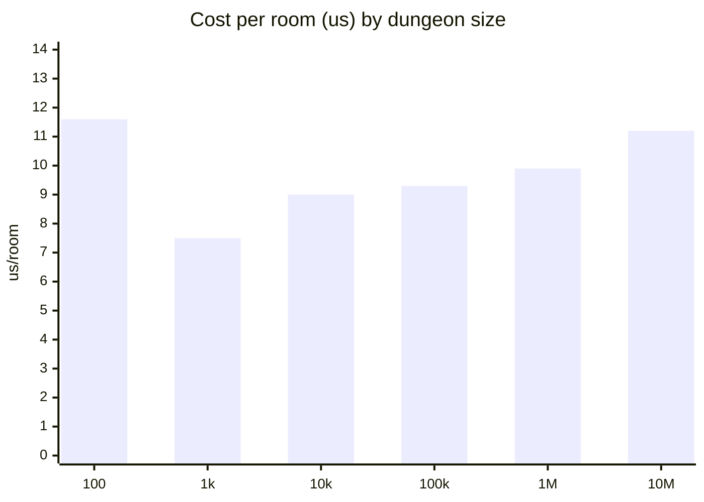
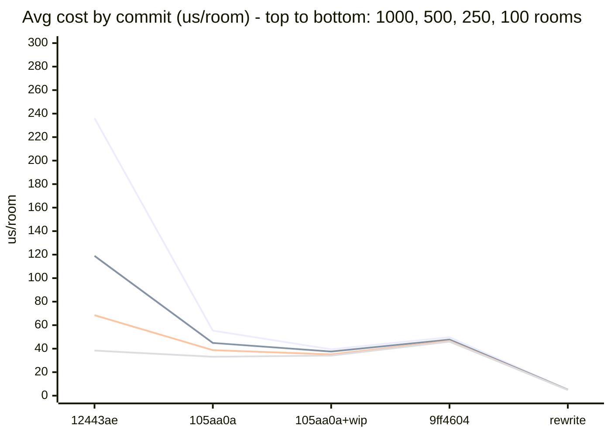

# bevy_ldtk_procgen - Spec & Benchmarks

Human-readable spec of the generation algorithm, plus a running performance log.
Each commit's version of this file is a snapshot, so a future version can be compared
against today's numbers with plain git history rather than a separate benchmark tool.

## Architecture

Rooms are authored in LDtk, one level per room. Each level carries `Door` entities flush
against its edges, plus optional tags: bool tags from the project-wide `RoomTags` enum,
and float fields (`weight` is the room's base selection weight).

The crate is split in two:

- `src/generator/` is pure Rust, with no Bevy: the `Catalog` (every room, parsed once and
  then immutable), the `Layout` (which rooms are placed where; append-only, and the single
  source of truth), and the placement algorithm. Everything is in integer tiles, and the
  tile size is read from the project, never hardcoded.
- `src/plugin/` is the Bevy side: loading the `.ldtk`, running generation each frame,
  and spawning or despawning `bevy_ecs_ldtk` levels for the part of the Layout near a
  `GenerationAnchor`.

Startup gates through `GenerationState`: `Loading -> Building -> Ready` (or `Failed`,
with errors that name the offending level).

Generation is **synchronous**, on the main thread, inside a per-frame budget. This
reverses the old async design: placement turned out to be cheap (see benchmarks), and the
frame-time problem was always tilemap spawning, which is throttled separately. Being
synchronous is what makes seeds reproducible without snapshotting world state.

Three rings around each anchor, set independently through `StreamingRadii` (also
changeable at runtime):

- **generation**: open doors within it get filled, as Layout data only.
- **spawn**: placed rooms within it get tilemap entities.
- **despawn**: spawned rooms beyond it are culled. Culling never touches the Layout, so
  coming back shows the same rooms.

The despawn ring is kept at least `max(10% of spawn, 2 tiles)` outside the spawn ring,
so no setting can load and unload a room on alternate frames.

## Algorithms

### Catalog - `build_catalog` (`generator/catalog.rs`)

Parses levels into `RoomDef`s: size, doors, tags. Doors come from one of two sources
(`DoorSource`, chosen at runtime):

- `Entities` (default): `Door` entities. Direction comes from which level edge the entity
  touches, and width from its extent along that edge.
- `IntGridGaps { layer }`: each maximal run of empty (`0`) cells along a level edge of
  the named IntGrid layer is a door that wide; any nonzero value is wall. Corners are
  excluded, and an open corner is a `DoorAtCorner` error, since its direction would be
  ambiguous. On the bundled 16px map both sources give identical doors for all 44 rooms
  (tested).

 Rooms are indexed by
(direction, width) in a 4-element array, never a `HashMap`, since iteration order would
break determinism.

The catalog also precomputes each door's **reservation**: the footprint of the smallest
single-door room (a "cap") that can always fill a door of that direction and width. A
project with no cap room for some direction fails to load with
`NoCapRoomForDirection`. A room whose own doors' reservations overlap can never be
placed: it's warned about at load, naming the level and doors, and is never picked as a
start room unless named explicitly.

### Door reservations - the placement invariant

Every open door keeps its reservation free. Placement must keep two invariants:

1. No room body overlaps an open door's reservation, except the room filling that door.
2. Open doors' reservations are pairwise disjoint.

So every open door can always be closed by at least its cap room: a door can never be
sealed, two doors never compete for the same space, and no door is born facing another
room's wall. This replaces the old clearance boxes and the recursive bridging search
(`find_bridging_room`), which existed to repair conflicts that now can't happen.

### Placing a room - `attempt_door` (`generator/place.rs`)

For one open door: list the catalog rooms with a matching door (opposite direction, same
width), weight them (`weight` tag, optional consumer weight table, meta-generation
quotas and closure bias), then draw without replacement until one fits. A candidate fits
when:

1. Its body overlaps no placed room (queried from the room `SpatialHash`).
2. Its body touches no open door's reservation except the door being filled, and it
   connects every other open door it lands exactly on.
3. Each new door it opens gets a reservation that is free of room bodies and disjoint
   from every other open door's.

If no candidate fits, the attempt fails. Because of reservations this is rare: 0.0% of
attempts in the scaling runs below (up to 10M rooms).

### Spatial indexing - `SpatialHash` (`generator/spatial.rs`)

A uniform grid whose cell size is the largest room dimension in the catalog, so a room
touches at most four cells. Two indices:

- **rooms**: placed room bodies. Append-only.
- **open doors**: each door's tile together with its reservation, removed when the door
  closes. Open doors live in a slot map (`OpenDoorId` = slot plus generation), so an id
  held across frames can't silently point at a different door.

Every check above is a local query, so the cost of placing a room doesn't grow with the
dungeon (see benchmarks). Lookups that need determinism sort by slot; no `HashMap` is ever
iterated during placement.

### Which door next - `GenerationOrder` (`plugin/systems.rs`, `generator/frontier.rs`)

- `NearestAnchor` (default): fill the open doors nearest any anchor first, up to
  `PlacementBudget::nearest_anchor_rooms` (default 64) placements a frame. A count, not a time budget, so a fixed-seed
  run doesn't depend on machine speed. Same seed plus the same anchor route gives the
  same dungeon.
- `FromOrigin` (deterministic): start at (0, 0) and always fill the open door nearest the
  origin, out to the furthest distance any anchor has travelled plus the generation
  radius. A lazy min-heap keyed by (distance², y, x, ids) always takes the global
  minimum, so any route and any per-frame budget replays a prefix of one fixed sequence:
  same seed, same dungeon, every time. Budget: `PlacementBudget::from_origin_time` (default
  2 ms a frame), with `from_origin_max_rooms` (default 512) as a backstop.

`PlacementBudget` is a resource (`GeneratorPlugin::with_placement_budget`), changeable at
runtime.

Under either order, a door whose attempt fails is abandoned at once and reported with
`DoorAbandoned`, so the game can wall it off. Reservations guarantee every open door can
take its cap room, so a failure only means the weights excluded every candidate that fits
(a consumer table zeroing them, a quota, a depth gate), and a retry would fail the same
way. Before reservations, doors failed temporarily while their neighbourhood was still
growing, so `NearestAnchor` retried each one up to 300 times; that retry counter is gone.
On the bundled map no attempt fails at all (end-to-end test, and the `meta` example's
fixed-seed layout is identical before and after the change).

### Spawning - `sync_entities` (`plugin/systems.rs`)

Queries the room index around each anchor (falling back to a scan when the query rect
would cover more cells than there are rooms), and spawns the nearest unspawned rooms
first, up to a per-frame budget counted in **tiles of room area**. Spawn cost follows tile
count (`bevy_ecs_tilemap` makes one entity per tile), so a tile budget works the same for
small and large rooms at any grid size. At least one room spawns per frame regardless.
Spawning is far more expensive than placing (~2.6 µs per tile, ~0.1 ms for a typical
16px room, vs ~10 µs to place one), which is why rooms are placed well ahead of the spawn
ring.

The budget (`SpawnBudget`) is `Adaptive { min_tiles: 32, max_tiles: 16384 }` by default,
or `Fixed(tiles)`. Spawn cost doesn't land in `sync_entities` but over the next frames
(level processing, tilemap meshing), so the adaptive budget is driven by frame time:

- **Baseline:** an average of frame times while nothing has spawned for 3 frames. While
  spawning, a faster frame pulls it down (smoothed, since vsync frame times jitter). It
  only creeps up while frames run long with the budget already at its minimum, which
  means the baseline itself is wrong (e.g. the window moved to a slower display).
- **Long frame:** over the baseline by `max(30% + 1 ms, 4 ms)`. Under vsync that's a
  missed refresh; without it, a few ms isn't a stutter.
- **On a long frame:** the budget halves from what was actually spawned, and a ceiling is
  set at 75% of it. The ceiling holds for 120 smooth frames, then lifts by 1% + 8 tiles a
  frame, so a sustained load probes it at most every couple of seconds.
- **Otherwise:** the budget grows by `max(12.5%, 32 tiles)`, up to the ceiling, but only if
  the frame used at least half of it, so rooms trickling in don't inflate a budget the next
  burst would then spend all at once.

Simulated (unit tests, continuous loading): a fast machine without vsync settles at ~1180
tiles/frame, a 3x slower one on 60 Hz at ~640 (of 833 possible), a 10x slower one at ~80
(of 100), each with under 1% of frames running long; it recovers after the window moves
from a 144 Hz display to a 60 Hz one. In the `testing` example on 60 Hz: ~180-390 rooms
load in 0.07-0.12 s with no frame over 20 ms (the old fixed 4 rooms a frame took ~1.2 s).

### RNG and seeds

One `SmallRng` per dungeon, seeded from the plugin's seed. With no seed given, one is
drawn up front from OS entropy and published as `GenerationSeed`, so every dungeon can
be reported and rebuilt with `Regenerate { seed: Some(seed) }`. Never read from the
environment.

## Current Performance

Release build, bundled 16px catalog (`ezraclintoc_kenney-tiny-dungeon_16px_fixeddoors.ldtk`).

**Reach by target** (`bench_reach_by_target`, same method as the history table below:
50 seeds, whole catalog unweighted, deterministic order):

- **100 rooms**: 4.77 µs/room (46/50 seeds reached target)
- **250 rooms**: 4.91 µs/room (44/50)
- **500 rooms**: 5.05 µs/room (44/50)
- **1000 rooms**: 5.22 µs/room (44/50)

Cost climbs 1.09x over a 10x larger target, and stops climbing after that. The 6 seeds
that don't reach 100 rooms close off early because the unweighted catalog is mostly dead
ends, not because placement fails; consumers wanting an endless dungeon use a weight table
(see the `halls` example).

**Scaling: 100 to 10 million rooms** (`bench_placement_scaling` with `BENCH_ROOMS=N`;
door-count weights so the dungeon never closes, deterministic order; measured at
`1ee5b4f`, Bevy 0.20). Per-room cost is the marginal cost over the last 10% of rooms
placed (pick a door + place a room), the median of 5 runs up to 100k, 3 runs at 1M,
1 run at 10M.



| Rooms | Per room | Rooms/s | Total build | Open doors | Memory (RSS) | Failed |
|---|---|---|---|---|---|---|
| 100 | 11.6 µs | 86k | ~1 ms | 20 | 28 MB | 0.0% |
| 1k | 7.5 µs | 133k | ~8 ms | 49 | 28 MB | 0.0% |
| 10k | 9.0 µs | 111k | ~90 ms | 146 | 29 MB | 0.0% |
| 100k | 9.3 µs | 108k | 0.9 s | 567 | 31 MB | 0.0% |
| 1M | 9.9 µs | 101k | 9.4 s | 1,642 | 54 MB | 0.0% |
| 10M | 11.2 µs | 89k | 110 s | 5,208 | 315 MB | 0.0% |

The math:

- **Per-room cost is O(1).** 10,000x more rooms (1k to 10M) costs 1.5x more per room,
  and that 1.5x is the spatial index outgrowing CPU cache, not more work: every lookup
  touches a fixed number of hash cells whatever the dungeon size. The 100-room figure is
  the noisiest (10 rooms per sample, cold caches; runs ranged 7.4-12.7 µs).
- **Total build time is O(N):** N x ~10 µs. A full million-room dungeon is ~10 s of CPU,
  but the plugin never builds it at once: at the default `PlacementBudget` of 64 rooms
  per frame, placement costs 64 x ~10 µs = ~0.65 ms of a 16.7 ms frame.
- **Memory is O(N) at ~29 bytes/room:** (315 MB - 28 MB baseline) / 10M. 12 B is the
  `Placement` itself; the rest is the room index.
- **Open doors grow with the perimeter, ~O(sqrt N):** 10x the rooms gives ~3x the open
  doors (567 at 100k, 1,642 at 1M, 5,208 at 10M), so the frontier stays tiny.
- **No placement fails at any size** (door reservations guarantee a cap room always fits).

This run costs more per room than the reach benchmark above because the door-count
weights favour bigger, many-doored rooms, which have more to check.

**In the app** (Chrome trace of the `testing` example): the generator takes under 0.2 ms
of a frame while streaming; frame time is bound by vsync, with no hitches.

How to run:

```bash
cargo test --release --lib bench_ -- --ignored --nocapture
BENCH_ROOMS=10000000 cargo test --release --lib bench_placement_scaling -- --ignored --nocapture
```

## Benchmark History

Each row: for each target room count, 50 seeds are tried and only the runs that *reach*
that target are averaged (a run that closes early is excluded, so it can't masquerade as
a speed change). Cells are `avg us/room (seeds reached/50)`; `N/A` means no seed reached
that target. Rows up to `9ff4604` are the old async implementation
(`generation_speed_by_target`, `assets/rooms.ldtk`); from the rewrite on,
`bench_reach_by_target` with the 16px fixed-doors catalog, so the catalog differs too.

| Date       | Commit        | 100 rooms     | 250 rooms     | 500 rooms      | 1000 rooms     | Notes                                                                                                                                                                                                                                                                                                                                                                                                                                                                                                              |
|------------|---------------|---------------|---------------|----------------|----------------|--------------------------------------------------------------------------------------------------------------------------------------------------------------------------------------------------------------------------------------------------------------------------------------------------------------------------------------------------------------------------------------------------------------------------------------------------------------------------------------------------------------------|
| 2026-07-08 | `12443ae`     | 38.37 (41/50) | 68.46 (39/50) | 118.93 (35/50) | 236.18 (22/50) | Baseline before spatial hashing. Numbers refreshed on a second run of the same pending (uncommitted) working tree - small movement vs. the first measurement is normal seed noise, not a code change.                                                                                                                                                                                                                                                                                                              |
| 2026-07-08 | `105aa0a`     | 33.13 (30/50) | 38.73 (18/50) | 44.87 (7/50)   | 55.31 (1/50)   | First post-spatial-hashing measurement (feature/spatial-hashing rebased onto main). Per-room cost flattened a lot (see Current Performance), but seed-reachability at higher targets dropped sharply - suspected bridging-validation bug (pretend.add_room now runs open-door bookkeeping it didn't before), not a speed regression. Needs follow-up before trusting the 1000-room number.                                                                                                                         |
| 2026-07-10 | `105aa0a`+wip | 34.12 (34/50) | 35.13 (23/50) | 37.54 (15/50)  | 39.46 (6/50)   | Uncommitted working tree on top of 105aa0a - adds multi-pass branch chaining to generate_batch (chains a branch multiple rooms deep per async batch) and a SpawnQueue frame-rate limiter to poll_task; numbers reflect the working tree, not a specific commit. Per-room cost climb flattened further (~1.16x vs ~1.67x), and 1000-room seed-reachability partially recovered (6/50 vs 1/50) but is still well short of the pre-spatial-hash 22/50 - the suspected bridging-validation regression remains unfixed. |
| 2026-07-10 | `9ff4604`     | 45.96 (41/50) | 46.51 (37/50) | 47.73 (32/50)  | 49.74 (24/50)  | lib/examples restructure plus GenerationConfig (camera_spawn_dist/max_rooms configurable, no algorithm change) bundled with a substantial assets/rooms.ldtk content change (~10% more entities). Seed-reachability jumped a lot at every target; since none of this commit's code changes touch try_place_room/bridging, the larger room catalog is the leading suspect, not the code - not yet isolated from the asset change to confirm.                                                                         |
| 2026-11-11 | rewrite       | 4.77 (46/50)  | 4.91 (44/50)  | 5.05 (44/50)   | 5.22 (44/50)   | Synchronous rewrite (`rewrite/generator`): door reservations, spatial index for rooms and open doors, deterministic `FromOrigin` order. ~10x cheaper per room than the async version at 1000 rooms, cost flat across targets, and reachability at 1000 rooms up from 24/50 to 44/50. Different catalog from earlier rows, so the absolute numbers aren't a like-for-like comparison; the flatness and reach are the meaningful part. Scaling checked separately to 10M rooms (see Current Performance). |

### Performance Chart

x-axis = commit history, one line per target; Mermaid's `xychart-beta` has no per-line
legend. Lines from top to bottom: 1000, 500, 250, 100 rooms. The gap between the top and
bottom line is "how much cost depends on dungeon size"; at the rewrite it's gone.


